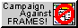

<!-- "Hero" Header -->

  
   
   
  
   
   

<!-- Social -->
<table width="100%" align="center">
<tr>
<td align="center">
<a href="https://t.me/veexelaa">
<strong>Write me on Telegram</strong>
 
 
 

</a>

</td>

<td align="center">
<a href="">
<strong>Listen to cool music</strong>
 
 

</a>

</td>
</tr>
</table>

<!-- Guestbook -->
| Name | Date | Message |
|---|---|---|
| <a href="https://github.com/veexellaa"> veexellaa</a> | 2026-10-21 | hello |
<!-- /Guestbook -->

<!-- Footer -->

 

&nbsp;&nbsp;&nbsp;&nbsp;

&nbsp;&nbsp;&nbsp;&nbsp;

 
 
Inspired by <a href="https://github.com/BrunnerLivio">@BrunnerLivio</a>

